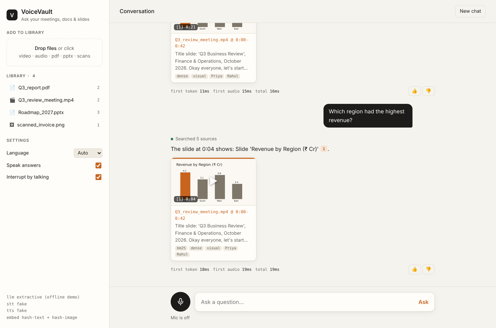
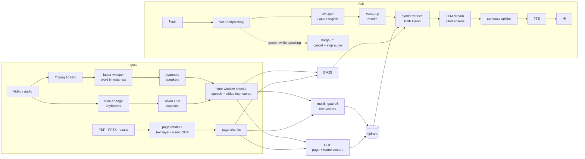

# 🎙️ VoiceVault

[](https://github.com/Aryan708/Voicevolt/actions/workflows/ci.yml)

**A voice-first multimodal RAG copilot.** Ask your meetings, lectures, slide decks, PDFs and scanned
documents questions *out loud*, in English, Hindi or Hinglish, and get a spoken answer that cites the
exact video timestamp, slide or page, with the image as proof.



> "Why did the Chennai launch slip?"
> → *"Rahul said at 0:24 that Shakti Logistics delayed the warehouse fit-out by about six weeks [1]…"*
> plus a card that opens the meeting video at 0:22 and shows the slide on screen at that moment.

---

## What it does

| | |
|---|---|
| 🎬 **Understands recordings** | Whisper transcription with word timestamps, speaker diarization, slide-change detection, vision-LLM captions of what's on screen |
| 📄 **Understands documents** | PDF text layer, vision OCR for scans/photos, PPTX/DOCX via LibreOffice, every page kept as an image |
| 🔎 **Hybrid multimodal search** | Multilingual dense embeddings + BM25 + CLIP image search, fused with Reciprocal Rank Fusion |
| 💬 **Grounded answers** | Claude / GPT / Llama (Ollama); answers only from your files with `[n]` citations; rewrites follow-up questions; replies in the user's language |
| 🗣️ **Real-time voice** | Voice-activity endpointing → STT → streamed LLM → sentence-by-sentence TTS; **barge-in** (talk over it to interrupt) |
| 🇮🇳 **Hinglish speech model** | LoRA fine-tune of Whisper on Hindi + code-switched speech, with a speaker-disjoint before/after WER report |
| 📏 **Measured** | Retrieval ablation (Recall@k, MRR, nDCG), LLM-judge faithfulness / citation precision, per-stage latency p50/p95 |
| 👍 **Learns from feedback** | Thumbs up/down → SFT examples + DPO preference pairs (the data side of RLHF) |
| 🐳 **Deployable** | FastAPI + WebSocket, Docker Compose with a Qdrant server, CI on every push |

## Architecture



A deeper walk-through (data model, threading, latency budget, failure handling) is in
[docs/ARCHITECTURE.md](docs/ARCHITECTURE.md).

## Quick start

```bash
git clone https://github.com/Aryan708/Voicevolt.git && cd Voicevolt
```

### 1. Offline demo: 2 minutes, no API keys, no model downloads
```bash
pip install -r requirements-ci.txt   # lightweight, no torch
make demo-data                       # sample meeting video, report, deck, scanned invoice
make demo                            # → http://localhost:8000
```
`make demo` uses deterministic offline stand-ins (a quoting "extractive" answerer, hash embeddings), so
it shows the full UI and flow but not real semantic quality. For that, use the full setup.

### 2. Full local setup
```bash
# system: ffmpeg (+ LibreOffice for pptx/docx)
#   Windows: winget install ffmpeg | macOS: brew install ffmpeg | Ubuntu: sudo apt install ffmpeg libreoffice
python -m venv .venv && source .venv/bin/activate     # Windows: .venv\Scripts\activate
pip install -r requirements.txt
cp .env.example .env                                  # add ANTHROPIC_API_KEY (or OpenAI / Ollama)

python scripts/make_demo_data.py --index              # real neural voices + Whisper + vision
make serve                                            # → http://localhost:8000
```
Add your own files by dragging them into the web app, or `python scripts/index.py path/to/folder`.

### 3. Docker
```bash
cp .env.example .env && docker compose up --build     # app + Qdrant server → http://localhost:8000
```

## Using it

| Command | |
|---|---|
| `make serve` | Web app: mic button for hands-free voice, upload library, cited answers, video jumps to timestamps |
| `python scripts/index.py data/raw/` | Ingest + index any mix of mp4, m4a, pdf, pptx, jpg… |
| `python scripts/search.py "chart of revenue by region"` | Hybrid search from the terminal (`--only visual` for ablations) |
| `python scripts/chat.py` | Text chat with citations and timings |
| `python scripts/make_eval_set.py -n 40` | Draft an English/Hindi/Hinglish eval set from your index |
| `python scripts/evaluate.py all` | Retrieval ablation + answer quality + latency + feedback export |

Configuration lives in `.env` (see [`.env.example`](.env.example)): providers for LLM / STT / TTS / vision,
models, chunking, keyframe sensitivity, retrieval weights, barge-in.

## Results

> Fill these tables from your own runs (`reports/eval/report.md`, `reports/asr/results.md`). The
> numbers you publish should be ones you measured.

**Speech recognition, held-out speakers** (`finetune/evaluate_asr.py`)

| Model | WER | CER | WER Hindi | WER Hinglish |
|---|---|---|---|---|
| whisper-small | _..._ | _..._ | _..._ | _..._ |
| **whisper-small + LoRA (ours)** | _..._ | _..._ | _..._ | _..._ |

**Retrieval ablation** (`scripts/evaluate.py retrieval`)

| Retrievers | Hit@5 | MRR | nDCG@5 |
|---|---|---|---|
| dense only | | | |
| BM25 only | | | |
| CLIP visual only | | | |
| **hybrid (RRF)** | | | |

**Answer quality and latency** (`scripts/evaluate.py rag`, `latency`): faithfulness, citation precision,
declines-unanswerable rate; voice-to-first-audio p50/p95.

## Fine-tuning Whisper for Hinglish

See [finetune/README.md](finetune/README.md), or open
[`finetune/whisper_lora_colab.ipynb`](finetune/whisper_lora_colab.ipynb) in Colab on a free T4.
Data prep (FLEURS + your own recordings, filtered, speaker-disjoint) → LoRA training → merge + CTranslate2
export → before/after WER by script → `STT_MODEL=models/.../ct2` plugs it into VoiceVault.

## Key design decisions

| Decision | Why |
|---|---|
| **Slide-aware keyframes** instead of ffmpeg scene scores | Scene scores measured 0.05-0.26 on real text-only slide changes (threshold 0.3), so they were all missed. Detecting "changed, then held still" catches every slide and ignores moving webcams |
| Speech + slide captions **interleaved in one chunk** | The LLM can say "Rahul said X *while the slide showed* Y", and one search hit carries both |
| **Three retrievers + RRF** | Dense for paraphrase & Hindi, BM25 for names/IDs/numbers, CLIP for charts & scans with no text. RRF fuses ranks, so scores never need calibrating |
| Separate **image collection** | A 45-s chunk spanning 3 slides gets 3 visual entry points, and the proof image shown is the frame that matches the question |
| **Sentence-level TTS streaming** | Speaking starts after the first sentence, not the whole answer, the biggest latency win in a voice agent |
| **Barge-in** via server-side VAD + cancellation | Feels like a conversation; interrupted answers are not added to history |
| Word-level speaker alignment | Whisper segments often span two speakers; splitting at words fixes mislabels |
| LoRA, speaker-disjoint test set, Hindi-aware WER | Cheap to train, honest to evaluate, and `३` vs `3` or `।` vs `.` don't count as errors |
| Fake / hash / extractive backends | The whole system and its 68 tests run offline in CI, with no GPU or API keys |

## Project layout
```
voicevault/
├── voicevault/
│   ├── ingest/        media, transcribe, diarize, video (keyframes), vision, documents, chunker, pipeline
│   ├── embed.py       multilingual text + CLIP embedders (+ offline hash backend)
│   ├── store.py       Qdrant: chunks + images collections (embedded or server)
│   ├── retrieval.py   indexer, BM25, hybrid retriever, RRF, proof-image selection
│   ├── llm.py         Anthropic / OpenAI / Ollama / extractive / fake
│   ├── rag.py         prompts, citations, follow-up rewriting, streaming answers
│   ├── voice/         vad, stt, tts, sentence streaming, real-time session with barge-in
│   ├── server/        FastAPI app (REST + WebSocket) and the single-file web UI
│   └── eval/          ASR metrics, retrieval metrics, LLM-judge RAG eval, feedback → SFT/DPO
├── finetune/          Whisper LoRA: prepare_data, train_lora, export_model, evaluate_asr, Colab notebook
├── scripts/           index, search, chat, ingest, make_demo_data, make_eval_set, evaluate
├── tests/             68 tests: offline, deterministic
├── docs/              architecture, demo script, resume & interview notes
├── Dockerfile · docker-compose.yml · Makefile · .github/workflows/ci.yml
```

## Limitations and next steps
- Diarization labels speakers `SPEAKER_00…`; mapping them to names needs enrolment or a manual rename.
- CLIP ViT-B/32 is weak at reading small text in images; vision-LLM OCR covers that at extra cost.
  ColPali-style page embeddings would be the next upgrade.
- Embedded Qdrant is single-process. Use the Compose setup (Qdrant server) for multiple workers.
- No authentication or multi-tenant isolation yet. Don't expose the server publicly as-is.
- Feedback is collected and exported as DPO pairs; actually training a preference-tuned model is future work.

## License
MIT
